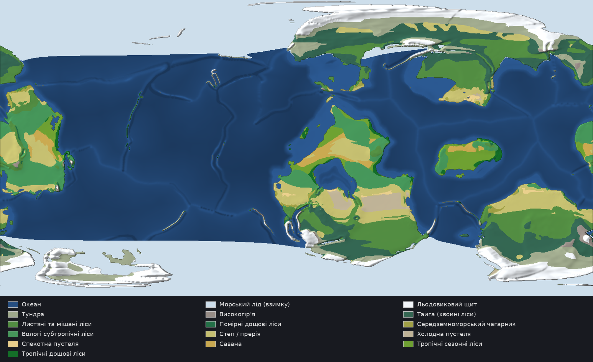
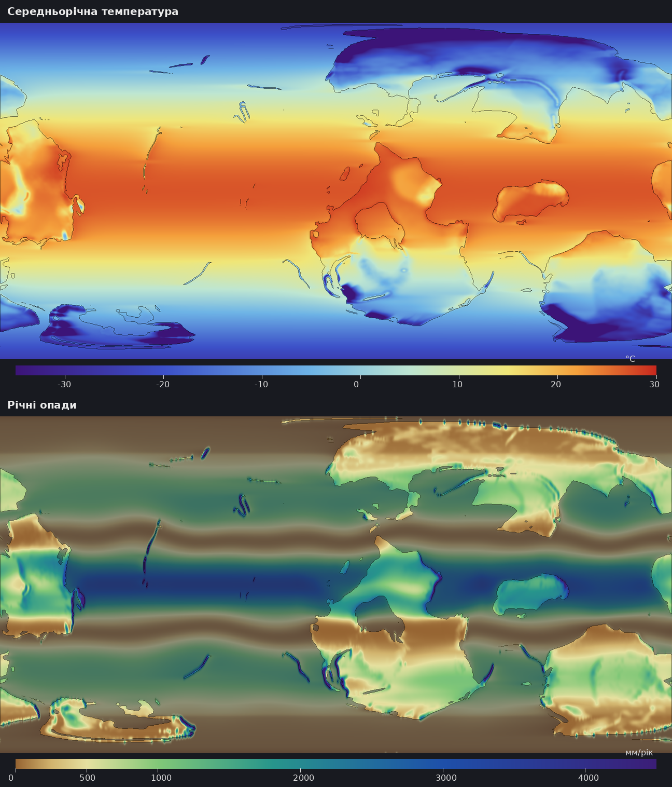
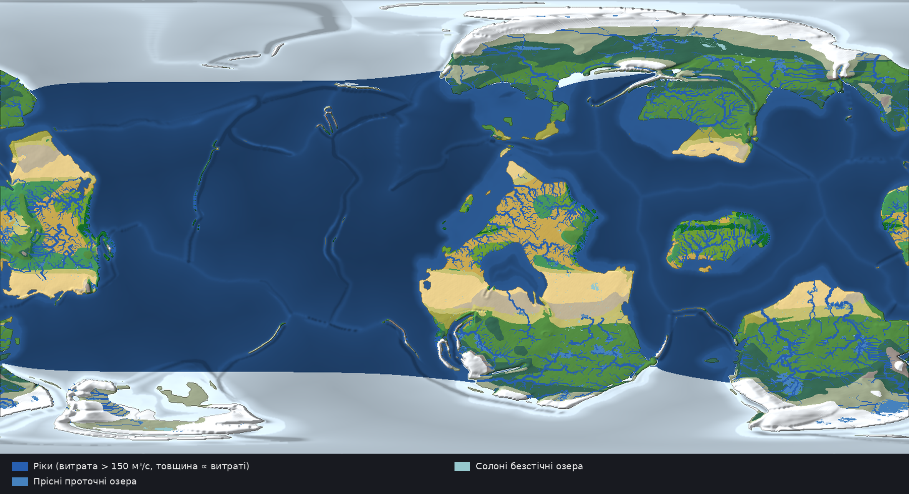
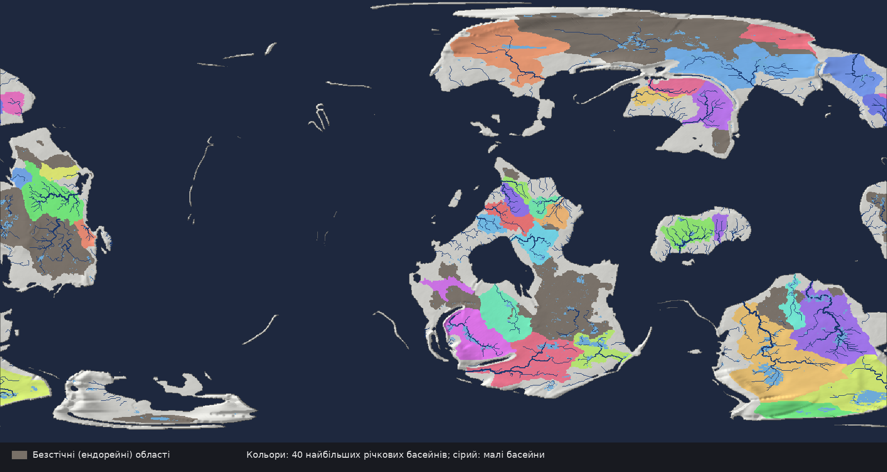

# Fictional World Map

A fictional Earth-like planet built from scratch, step by step, as the map for a city-building / RPG game.
Every step is generated by a script from the results of the previous step, so the whole world is reproducible from one seed.

## Pipeline

| # | Step | Status | Script | Main outputs |
|---|------|--------|--------|--------------|
| 1 | Planet parameters | Done | — | see below |
| 2 | Tectonic plates and continents | Done | `scripts/plates.py` | `output/plates_map.png`, `output/history.png`, `output/world_plates.*` |
| 3 | Global relief (heightmap) | Done (v1) | `scripts/heightmap.py` | `output/relief_map.png`, `output/heightmap_16bit.png`, `output/world_height.*` |
| 4 | Climate: winds, currents, temperature, precipitation, biomes | Done (v1) | `scripts/climate.py` | `output/biome_map.png`, `output/climate_maps.png`, `output/world_climate.*` |
| 5 | Hydrology and erosion: rivers, lakes, basins | Done (v1) | `scripts/hydrology.py` | `output/rivers_map.png`, `output/basins_map.png`, `output/world_hydrology.*` |
| 6 | Game region: zoom in, detail, peoples and history | Next | — | — |

## 1. Planet

| Parameter | Value |
|-----------|-------|
| Type | Earth-like |
| Radius | 6 371 km (gravity ~1 g) |
| Star | Sun-like yellow star |
| Age | ~4.5 billion years |
| Axial tilt | ~20–25° (moderate seasons) |
| Ocean share | ~71% |
| Supercontinent cycle phase | Recent breakup (option A): several continents, many coastlines, inland seas |

## 2. Tectonic plates

Model: noise-warped spherical Voronoi plates at breakup time, one elongated supercontinent plus microcontinents.
Each plate gets an Euler pole; continental plates drift away from the old supercontinent centre.
All plates are rotated forward by 150 million years. Overlaps resolve by buoyancy (oceanic crust subducts),
gaps become new oceanic crust split between neighbours (mid-ocean ridges).
Boundaries are classified by relative plate velocity as convergent, divergent or transform.

Result (seed 7): 16 plates (8 major), plate speeds 0.2–2.9 cm/yr, ~31% continental crust.


## 3. Relief

Rules applied to the plate boundaries:

- continent–continent convergence → broad high ranges and plateaus
- ocean–continent convergence → coastal cordillera with volcanoes + deep trench offshore
- ocean–ocean convergence → volcanic island arc on the overriding plate + trench
- divergence in ocean → mid-ocean ridge; sea floor deepens with distance from it (crust age)
- divergence in continent → rift valley with raised shoulders
- continental interiors → plains, uplands, basins and old eroded ranges
- continental margins → shelf (~ −120 m) and slope to the abyssal plain

Sea level is set so that land covers 29% of the surface.

Result (seed 7): highest peak 8 837 m, deepest trench −10 060 m, mean land 974 m, mean ocean −3 626 m.

Known limitation of v1: some convergent ranges look like straight walls along coasts; step 5 (erosion and rivers) will break them into valleys and spurs.


## 4. Climate and biomes

Two seasons are modelled (northern July and northern January), axial tilt 23°.

- **Temperature**: latitude (insolation), lapse rate 6.5 °C/km, seasonal amplitude growing with latitude and continentality
  (distance travelled over land from the upwind ocean), coastal influence of ocean currents.
- **Ocean currents** (sea-surface anomalies): cold currents off subtropical west coasts, warm drift towards high-latitude west coasts,
  warm western-boundary currents in the subtropics, cold currents off high-latitude east coasts.
- **Winds**: trade easterlies, westerlies, polar easterlies; belts shift 5° with the seasons and meander with longitude.
- **Rain belts**: ITCZ pulled poleward over large continents in summer (monsoons), dry subtropical highs, wet storm tracks, dry poles.
- **Moisture transport**: moisture evaporates over the ocean (more over warm currents), moves downwind, rains out over land,
  gets extra rain on windward slopes, leaves rain shadows behind ranges, and is partly recycled by vegetation.
- **Subtropical highs**: no convection and descending dry air that dilutes moisture; land under them is warmer than the
  ocean at the same latitude (less evaporative cooling, clear skies).
- **Climate classes**: Köppen-Geiger rules as used by Peel et al. (2007), approximated from the two modelled seasons;
  biomes are derived from the Köppen class.

Calibration: the sea-level temperature profile is fitted to Earth's zonal-mean temperatures, global mean precipitation is
set to the GPCP value (982 mm/yr). Moisture-transport coefficients were tuned until the climate passed the checks in
[VALIDATION.md](VALIDATION.md); the physics stayed the same, only the strengths were adjusted.

Result (seed 7): mean land temperature 8.0 °C, mean land precipitation ~844 mm/yr.
Köppen groups by land area: A 19%, B 22%, C 12%, D 34%, E 13%; hot desert 11%, savanna 11%.

Known limitations of v1: winds are modelled along latitude only, so climate-belt edges are still fairly straight;
two seasons approximate the monthly Köppen criteria.




## 5. Hydrology and erosion

- **Evapotranspiration and runoff**: reference evapotranspiration by Hargreaves-Samani (FAO-56) from monthly temperatures and
  solar geometry; actual evapotranspiration from the Budyko curve in Fu's form (w = 2.6); runoff = precipitation − evapotranspiration.
- **Terrain before erosion**: hills and low ridges at 100–500 km scale are added to land (the global relief had none).
  Hollows in wet climates and hollows smaller than 15 000 km² are filled (they would overflow or silt up over geological time);
  large hollows in dry climates stay as closed basins.
- **Flow routing**: priority-flood depression filling and D8 steepest descent on the sphere, with 40 m sub-grid roughness.
- **Fluvial erosion**: stream-power law E = K·Q^0.5·S, solved implicitly (Braun & Willett 2013) for 5 million years;
  eroded sediment settles in the first closed depression downstream.
- **Rivers in dry lands** lose water to evaporation over the channel and floodplain (width ∝ Q^0.5), so many desert rivers
  dry out before the sea.
- **Lakes**: each closed depression fills until lake evaporation (1.15 × PET − P) balances inflow. Lakes that reach their spill
  level overflow (fresh, open lakes); the others are terminal salt lakes and their basins are endorheic.
- No rivers are drawn on ice sheets (they drain through glaciers).

Result (seed 7): river discharge to the ocean 47,312 km³/yr (runoff ratio 0.408),
endorheic basins 18.8% of land, lakes 2.56% of land,
Hack exponent 0.501, bifurcation ratio 4.6.
Largest rivers by discharge: 68,103 m³/s (basin 4,315,817 km²), 52,376 m³/s (basin 6,716,693 km²), 49,472 m³/s (basin 2,369,666 km²).

Known limitations of v1: sediment is only deposited in closed depressions (no deltas or floodplain aggradation yet);
some coastal plains still drain through short parallel rivers; the 28 km grid only resolves large lakes and rivers.




## Scientific validation

Realism comes first: every step must pass `scripts/validate.py`, which compares the planet's statistics with published
Earth data (plates, hypsometry, precipitation, Köppen climate shares, water budget, river-network laws). Results and sources: [VALIDATION.md](VALIDATION.md).
A step is not done until all checks pass.

## Output files

All maps are equirectangular, 1440 × 720 px (~27.8 km/px at the equator).

| File | Content |
|------|---------|
| `plates_map.png` | Plates, boundary types, plate motion arrows |
| `history.png` | Supercontinent 150 Myr ago vs. today |
| `world_plates.npz` | Plate id, continental crust, new crust, collisions, boundary type and speed, Euler rotation vectors |
| `world_plates.json` | Seed, parameters and per-plate statistics |
| `relief_map.png` | Shaded relief with elevation legend |
| `heightmap_16bit.png` | 16-bit grayscale heightmap; 0 = −10 060 m, 65535 = +8 837 m (range is in `world_height.json`) |
| `world_height.npz` | Elevation in metres (float32) and land mask |
| `world_height.json` | Relief statistics |
| `biome_map.png` | Biomes with hillshade and legend |
| `climate_maps.png` | Annual mean temperature and annual precipitation |
| `world_climate.npz` | July/January/annual temperature, half-year and annual precipitation, biome id, SST anomaly |
| `world_climate.json` | Climate statistics, Köppen and biome shares, legends |
| `rivers_map.png` | Biomes with rivers, fresh and salt lakes |
| `basins_map.png` | 40 largest river basins and endorheic areas |
| `world_hydrology.npz` | Eroded elevation, erosion/deposition, discharge, upstream area, flow receiver, lakes, salt lakes, endorheic mask, basin id, Strahler order, PET, runoff |
| `world_hydrology.json` | Water budget, network statistics, largest rivers |
| `validation.json` | Machine-readable validation results |

## How to regenerate

Requires Python 3.10+ with `numpy`, `scipy`, `pillow` and `numba` (`pip install -r requirements.txt`).

```
cd fictional_map/scripts
python plates.py 7      # 7 = world seed
python heightmap.py     # reads the plates output
python climate.py       # reads the relief output
python hydrology.py     # reads relief and climate, erodes the terrain
python validate.py      # checks every step against Earth data, writes VALIDATION.md
```

A different seed produces a completely different planet. Steps must run in order.
