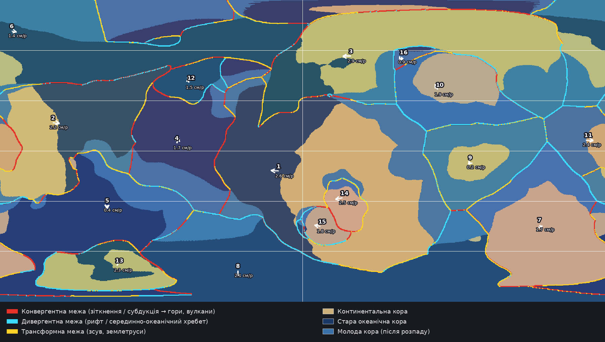
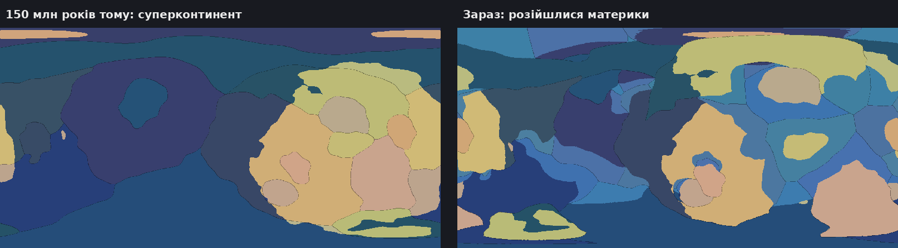
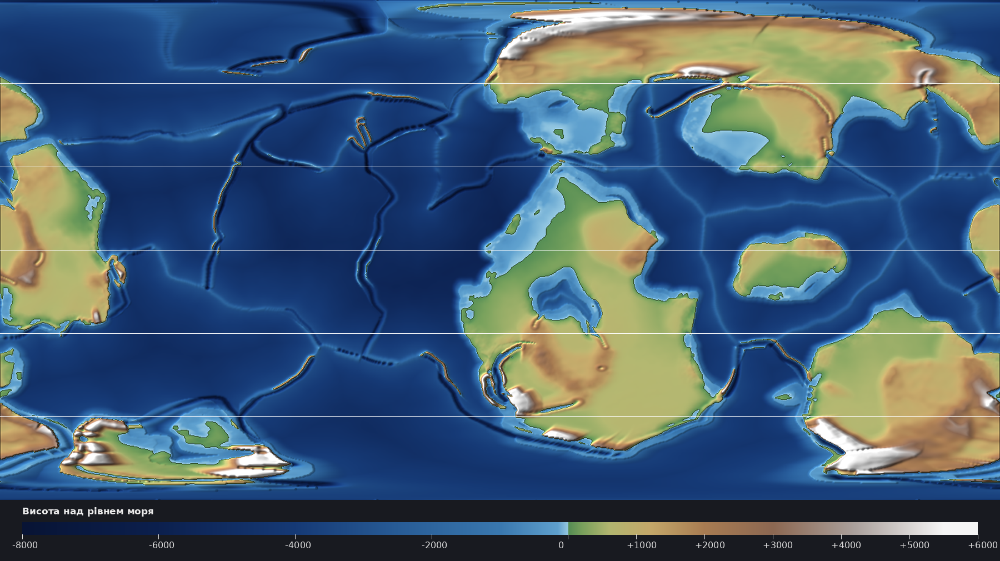

# Fictional World Map

A fictional Earth-like planet built from scratch, step by step, as the map for a city-building / RPG game.
Every step is generated by a script from the results of the previous step, so the whole world is reproducible from one seed.

## Pipeline

| # | Step | Status | Script | Main outputs |
|---|------|--------|--------|--------------|
| 1 | Planet parameters | Done | — | see below |
| 2 | Tectonic plates and continents | Done | `scripts/plates.py` | `output/plates_map.png`, `output/history.png`, `output/world_plates.*` |
| 3 | Global relief (heightmap) | Done (v1) | `scripts/heightmap.py` | `output/relief_map.png`, `output/heightmap_16bit.png`, `output/world_height.*` |
| 4 | Climate: winds, currents, temperature, precipitation, biomes | Next | — | — |
| 5 | Hydrology and erosion: rivers, lakes, deltas | Planned | — | — |
| 6 | Game region: zoom in, detail, peoples and history | Planned | — | — |

## 1. Planet

| Parameter | Value |
|-----------|-------|
| Type | Earth-like |
| Radius | 6 371 km (gravity ~1 g) |
| Star | Sun-like yellow star |
| Age | ~4.5 billion years |
| Axial tilt | ~20–25° (moderate seasons) |
| Ocean share | ~71% |
| Supercontinent cycle phase | Recent breakup (option A): several continents, many coastlines, inland seas |

## 2. Tectonic plates

Model: noise-warped spherical Voronoi plates at breakup time, one elongated supercontinent plus microcontinents.
Each plate gets an Euler pole; continental plates drift away from the old supercontinent centre.
All plates are rotated forward by 150 million years. Overlaps resolve by buoyancy (oceanic crust subducts),
gaps become new oceanic crust split between neighbours (mid-ocean ridges).
Boundaries are classified by relative plate velocity as convergent, divergent or transform.

Result (seed 7): 16 plates (8 major), plate speeds 0.2–2.9 cm/yr, ~31% continental crust.




## 3. Relief

Rules applied to the plate boundaries:

- continent–continent convergence → broad high ranges and plateaus
- ocean–continent convergence → coastal cordillera with volcanoes + deep trench offshore
- ocean–ocean convergence → volcanic island arc on the overriding plate + trench
- divergence in ocean → mid-ocean ridge; sea floor deepens with distance from it (crust age)
- divergence in continent → rift valley with raised shoulders
- continental interiors → plains, uplands, basins and old eroded ranges
- continental margins → shelf (~ −120 m) and slope to the abyssal plain

Sea level is set so that land covers 29% of the surface.

Result (seed 7): highest peak 8 837 m, deepest trench −10 060 m, mean land 974 m, mean ocean −3 626 m.

Known limitation of v1: some convergent ranges look like straight walls along coasts; step 5 (erosion and rivers) will break them into valleys and spurs.



## Output files

All maps are equirectangular, 1440 × 720 px (~27.8 km/px at the equator).

| File | Content |
|------|---------|
| `plates_map.png` | Plates, boundary types, plate motion arrows |
| `history.png` | Supercontinent 150 Myr ago vs. today |
| `world_plates.npz` | Plate id, continental crust, new crust, collisions, boundary type and speed, Euler rotation vectors |
| `world_plates.json` | Seed, parameters and per-plate statistics |
| `relief_map.png` | Shaded relief with elevation legend |
| `heightmap_16bit.png` | 16-bit grayscale heightmap; 0 = −10 060 m, 65535 = +8 837 m (range is in `world_height.json`) |
| `world_height.npz` | Elevation in metres (float32) and land mask |
| `world_height.json` | Relief statistics |

## How to regenerate

Requires Python 3.10+ with `numpy`, `scipy` and `pillow` (`pip install -r requirements.txt`).

```
cd fictional_map/scripts
python plates.py 7      # 7 = world seed
python heightmap.py     # reads the plates output
```

A different seed produces a completely different planet. Steps must run in order.
