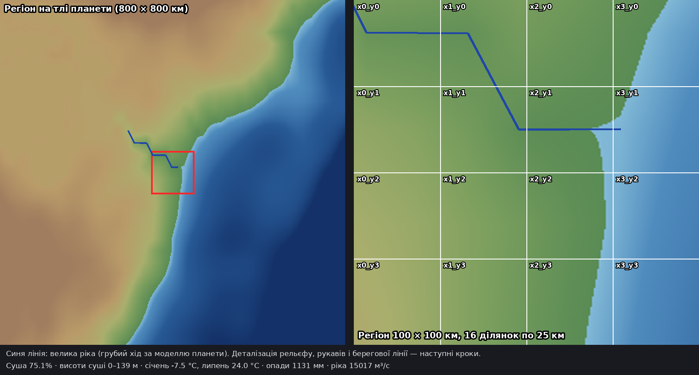
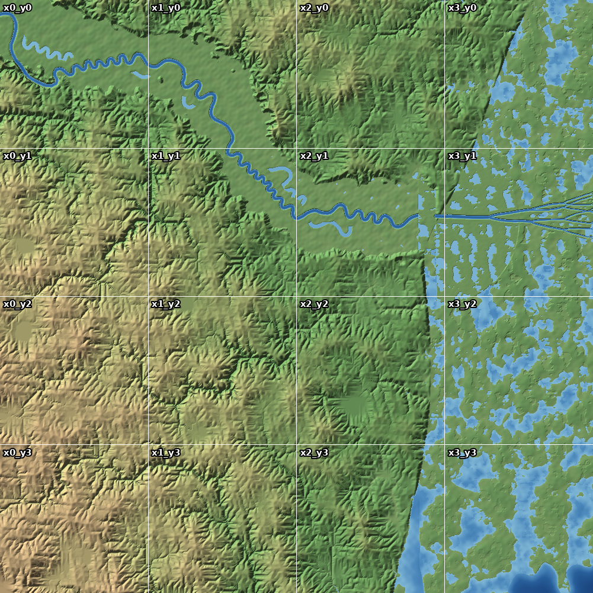
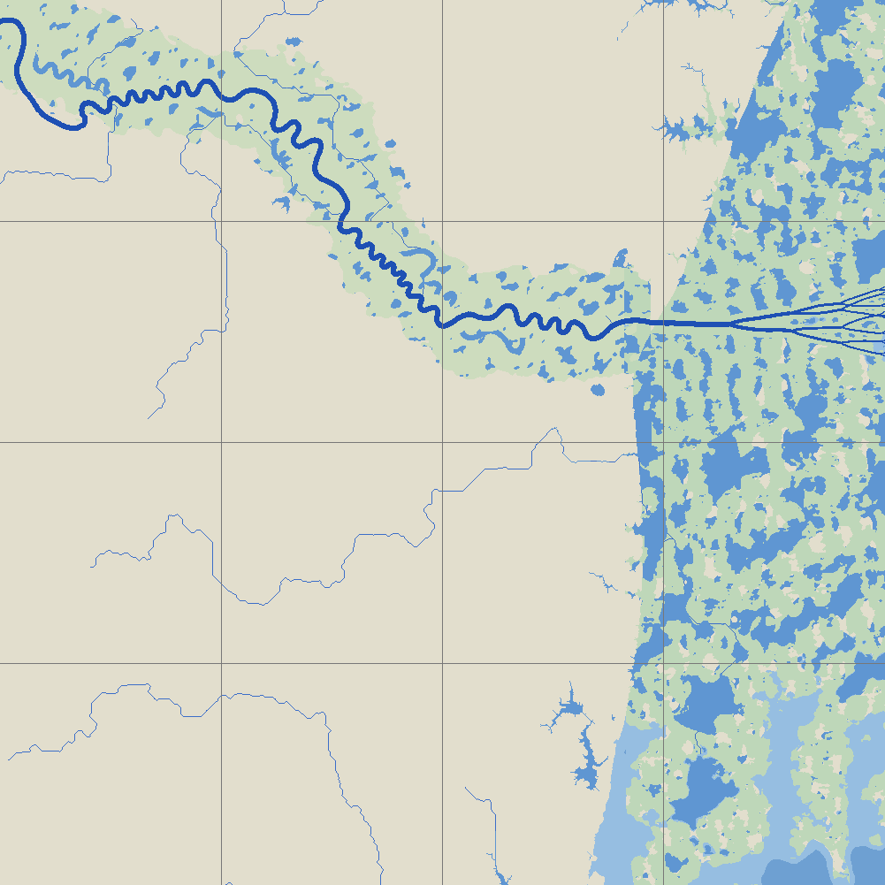

# Region `great_river_mouth`

Game map for the city-building / RPG game: a **100 × 100 km** square at the mouth of the planet's largest
temperate river, split into **16 plots of 25 × 25 km**. The player builds in one plot at a time and can switch between plots.

How to run the scripts: **[USAGE.md](USAGE.md)**.

## Where it is

- Northern continent, coast of a shallow shelf sea, 57.313–58.21° N.
- Stable continental platform far from plate boundaries: lowland, no young mountains or volcanoes.
- Planet-scale values: land 75.1% of the square, land elevation 0–139 m,
  sea down to 54 m.
- Climate Köppen Df (humid continental): January -7.5 °C, July 24.0 °C, 1131 mm/yr;
  the near-shore sea freezes in winter. Natural vegetation: mixed broadleaf–conifer forest.
- The river carries about 15,017 m³/s at its mouth; the mouth lies near the middle of plot `tile_x2_y1`.

## Plots

| | x0 (west) | x1 | x2 | x3 (east) |
|---|---|---|---|---|
| **y0 (north)** | tile_x0_y0 | tile_x1_y0 | tile_x2_y0 | tile_x3_y0 |
| **y1** | tile_x0_y1 | tile_x1_y1 | tile_x2_y1 (river mouth) | tile_x3_y1 |
| **y2** | tile_x0_y2 | tile_x1_y2 | tile_x2_y2 | tile_x3_y2 |
| **y3 (south)** | tile_x0_y3 | tile_x1_y3 | tile_x2_y3 | tile_x3_y3 |

Each plot: Unreal landscape 8129 × 8129 vertices, ~3.08 m between vertices (Scale X/Y 307.574, Z 100).
Neighbouring plots share their edge vertices, so there are no steps at plot borders.

## Status

| Step | Status |
|---|---|
| 0. Cut the region out of the planet (`extract_region.py`) | Done |
| 1. Regional process model at 100 m (`regional_model.py`, checks `validate_region.py`) | v2: sediment budget revised, 10/10 checks; delta shape being refined |
| 2. Plot detailing at ~3 m | Next |
| 3. Export for Unreal (heightmaps + layer masks) | Planned |

Every step must pass scientific validation before it is accepted, like the planet steps (see `../../VALIDATION.md`).
Regional checks: [VALIDATION.md](VALIDATION.md). Scientific decisions: [MODEL_NOTES.md](MODEL_NOTES.md).

## Regional model (100 m)

- Never glaciated, but periglacial (permafrost) at glacial maxima; sea level then ~120 m lower.
- Dissected lowland plain: dendritic valleys, local relief ~17 m per km, slopes mostly below 2.5°, heights 0–180 m.
- Main river ~610 m wide and ~20 m deep, meandering (sinuosity ~1.5) across a 10–18 km floodplain with oxbow lakes.
- Holocene delta: ~810 km³ of sediment (~250 Mt/yr), delta plain ~7 300 km², coast advanced up to ~115 km; most of the
  eastern half of the square is delta plain. The square stays in place; delta morphology is being refined (see MODEL_NOTES.md).

