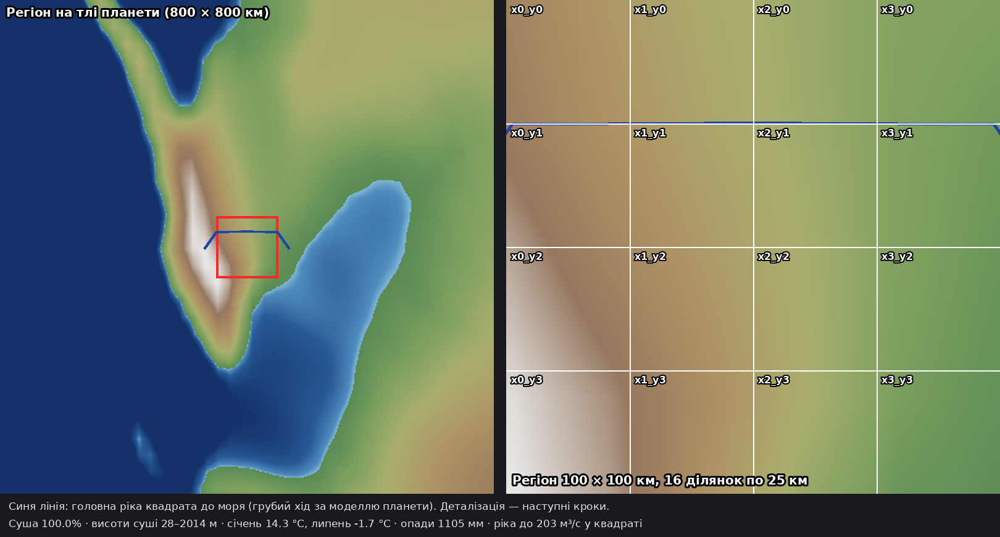
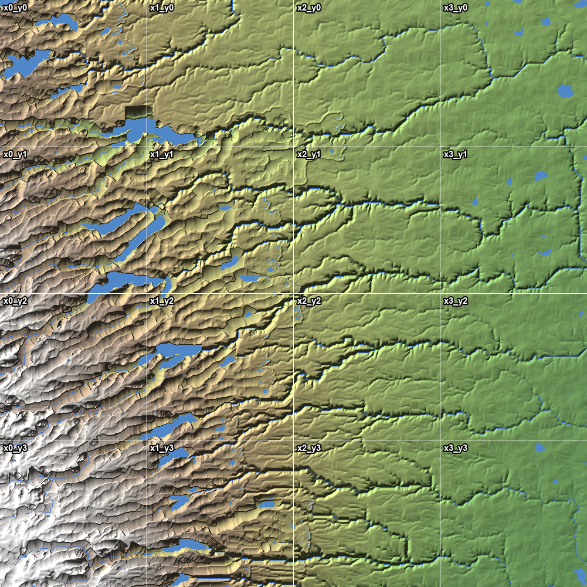
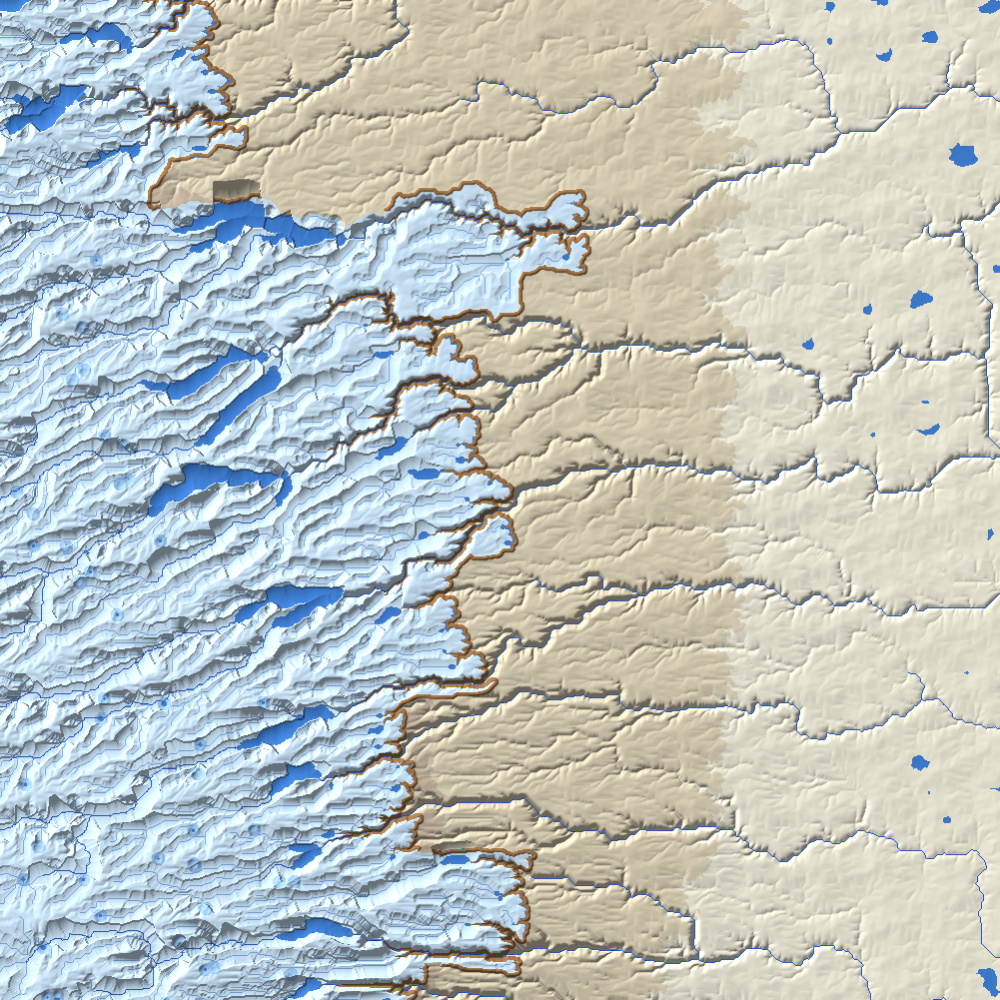
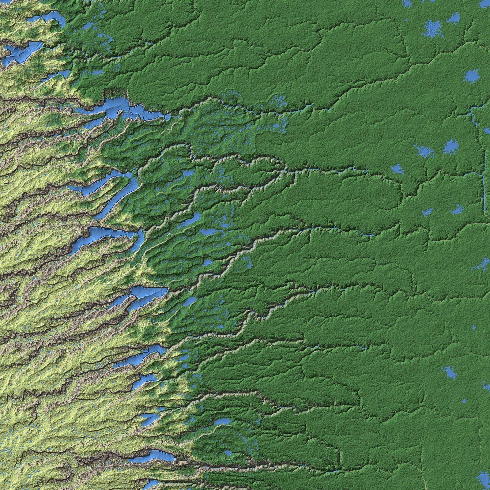
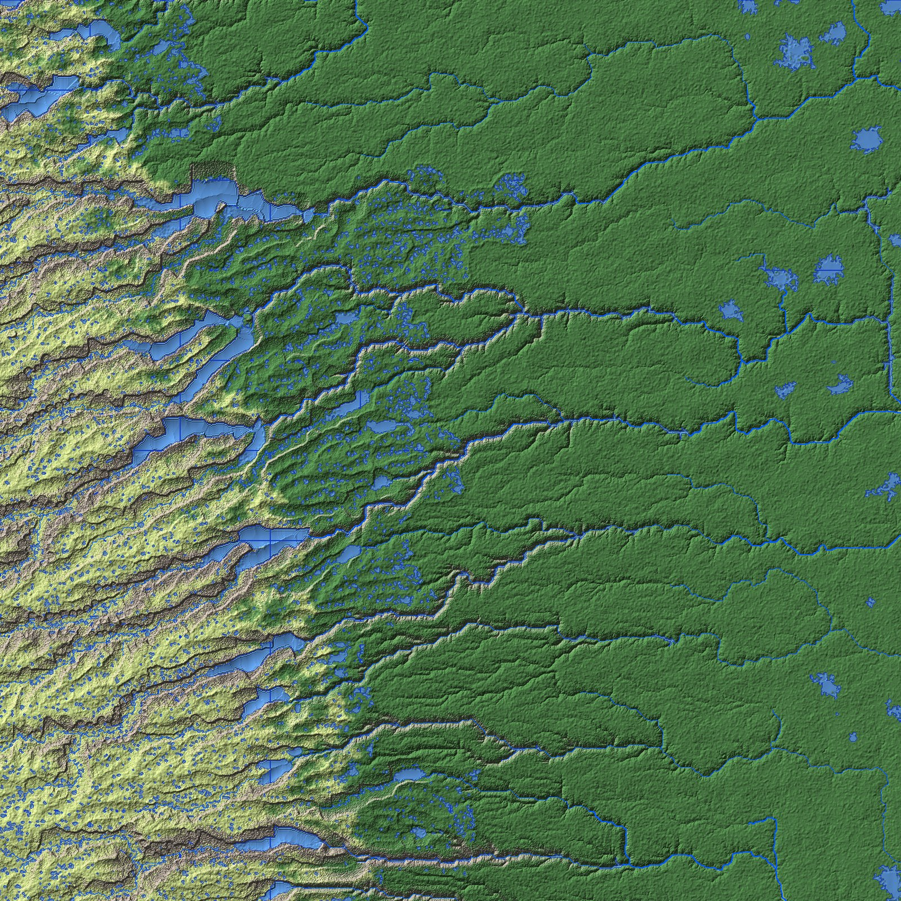

# Region `southern_coast_range`

Game map for the city-building / RPG game: a **100 × 100 km** square on the south-eastern continent with all three
kinds of landscape — **mountains, foothills and a river plain** — split into **100 plots of 10 × 10 km** (10 × 10).
The square's largest river flows from the range to the sea, which it reaches ~18 km east of the square.

How to run the scripts: **[USAGE.md](USAGE.md)**.

## Where it is

- South-eastern continent, west coast range, 45.151–46.047° S.
- Elevations 28–2014 m: mountains (> 1000 m) 30.6% of the square,
  foothills (300–1000 m) 42.0%, plain (< 300 m) 27.3%. The range lies in the west, the plain in the east.
- Climate (southern hemisphere: summer in January): plain Köppen Cf (mild winters around +1.5 °C, summers ~+18 °C),
  foothills Df with snowy winters, alpine tundra (ET) on the high range. Köppen shares of the square: Cf 39.2%, Df 44.6%, ET 16.3%.
  About 1105 mm of precipitation a year.
- Vegetation (planet scale): broadleaf and mixed forest below, conifer forest on the slopes, alpine tundra above.
- The largest river carries up to ~203 m³/s in the square and ~298 m³/s at its mouth.

## Plots

Plot names are `tile_x{col}_y{row}` (shortened below to `x{col}_y{row}`); each plot is 10 × 10 km.

| | x0 (west) | x1 | x2 | x3 | x4 | x5 | x6 | x7 | x8 | x9 (east) |
|---|---|---|---|---|---|---|---|---|---|---|
| **y0 (north)** | x0_y0 | x1_y0 | x2_y0 | x3_y0 | x4_y0 | x5_y0 | x6_y0 | x7_y0 | x8_y0 | x9_y0 |
| **y1** | x0_y1 | x1_y1 | x2_y1 | x3_y1 | x4_y1 | x5_y1 | x6_y1 | x7_y1 | x8_y1 | x9_y1 |
| **y2** | x0_y2 | x1_y2 | x2_y2 | x3_y2 | x4_y2 | x5_y2 | x6_y2 | x7_y2 | x8_y2 | x9_y2 |
| **y3** | x0_y3 | x1_y3 | x2_y3 | x3_y3 | x4_y3 | x5_y3 | x6_y3 | x7_y3 | x8_y3 | x9_y3 |
| **y4** | x0_y4 | x1_y4 | x2_y4 | x3_y4 | x4_y4 | x5_y4 | x6_y4 | x7_y4 | x8_y4 | x9_y4 |
| **y5** | x0_y5 | x1_y5 | x2_y5 | x3_y5 | x4_y5 | x5_y5 | x6_y5 | x7_y5 | x8_y5 | x9_y5 |
| **y6** | x0_y6 | x1_y6 | x2_y6 | x3_y6 | x4_y6 | x5_y6 | x6_y6 | x7_y6 | x8_y6 | x9_y6 |
| **y7** | x0_y7 | x1_y7 | x2_y7 | x3_y7 | x4_y7 | x5_y7 | x6_y7 | x7_y7 | x8_y7 | x9_y7 |
| **y8** | x0_y8 | x1_y8 | x2_y8 | x3_y8 | x4_y8 | x5_y8 | x6_y8 | x7_y8 | x8_y8 | x9_y8 |
| **y9 (south)** | x0_y9 | x1_y9 | x2_y9 | x3_y9 | x4_y9 | x5_y9 | x6_y9 | x7_y9 | x8_y9 | x9_y9 |

Each plot: Unreal landscape 4033 × 4033 vertices, ~2.48 m between vertices (Scale X/Y 248.016, **Z 1000**, because the
mountains rise above 256 m). Neighbouring plots share their edge vertices.

## Status

| Step | Status |
|---|---|
| 0. Cut the region out of the planet (`extract_region.py`) | Done |
| 1. Regional process model at 100 m (`regional_model.py`, checks `validate_region.py`) | Done (v1), 12/12 checks |
| 1b. 25 m refinement with cirques and outwash valley trains (`refine_25m.py`, checks `validate_landforms.py`) | Done (v2), 7/7 checks |
| 2. Plot detailing at ~2.5 m and export (`detail_plots.py`, checks `validate_plots.py`) | Done (v3, 100 plots of 10 km), PLOTS_RESULT checks |
| 3. Export for Unreal (heightmaps + 8 soft-blended layer weight maps) | Done (v2): generated locally into `export/`, see USAGE.md |
| 3a. Water bodies for Unreal's Water plugin (`export_water.py`, checks `validate_water.py`, editor script `ue_import_water.py`) | Done (v1), WATER_RESULT checks; editor script not yet tested in the engine |

Every step must pass scientific validation before it is accepted.
Regional checks: [VALIDATION.md](VALIDATION.md); landforms: [VALIDATION_LANDFORMS.md](VALIDATION_LANDFORMS.md);
plots: [VALIDATION_PLOTS.md](VALIDATION_PLOTS.md); water: [VALIDATION_WATER.md](VALIDATION_WATER.md). Scientific decisions: [MODEL_NOTES.md](MODEL_NOTES.md).

## Regional model (100 m)

- An old mountain range (no active plate boundary nearby) with valleys running from the crest in the west to the plain in the east.
- No glaciers today (equilibrium line ~2.7 km, summits ~2.1 km). In the last ice age
  (~8.1 °C colder) 44 valley glaciers covered ~40% of the square, reaching down to ~461 m.
- Their legacy: U-shaped troughs, cirques, moraines and long finger lakes in the mountain valleys (~247 km² of lakes).
- Mountains 25.3%, foothills 45.9%, plain 28.8% of the square.

## 25 m refinement (v2)

- 273 cirques at the heads of former glacier valleys (median width ~675 m, floor 8°, headwalls up to ~54°, walls ~290 m),
  matching global cirque morphometry; where their walls meet, arêtes and peaks remain.
- 10 outwash valley trains below the former ice fronts (~10 km², fill up to ~70 m, concave long profiles), cut by the
  Holocene river into terraces.

## Plots (3 m)

All 100 plots (mosaic of the previews) (colours = blended ground layers: rock, scree, alpine meadow, forest,
wet meadow, gravel, riverbed, lakebed):

## Water

Rivers (splines with width, depth and velocity) and lakes (outlines with water level) exported per plot for
Unreal's Water plugin:

