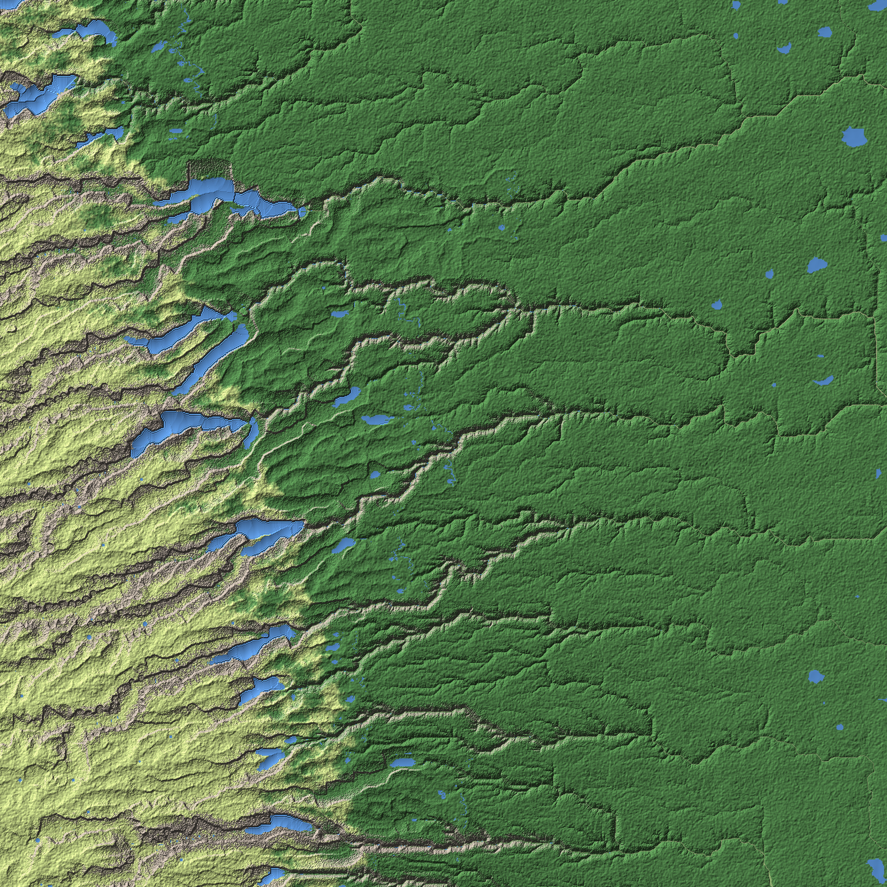

# Region `southern_coast_range`

Game map for the city-building / RPG game: a **100 × 100 km** square on the south-eastern continent with all three
kinds of landscape — **mountains, foothills and a river plain** — split into **16 plots of 25 × 25 km**.
The square's largest river flows from the range to the sea, which it reaches ~18 km east of the square.

How to run the scripts: **[USAGE.md](USAGE.md)**.

## Where it is

- South-eastern continent, west coast range, 45.151–46.047° S.
- Elevations 28–2014 m: mountains (> 1000 m) 30.6% of the square,
  foothills (300–1000 m) 42.0%, plain (< 300 m) 27.3%. The range lies in the west, the plain in the east.
- Climate (southern hemisphere: summer in January): plain Köppen Cf (mild winters around +1.5 °C, summers ~+18 °C),
  foothills Df with snowy winters, alpine tundra (ET) on the high range. Köppen shares of the square: Cf 39.2%, Df 44.6%, ET 16.3%.
  About 1105 mm of precipitation a year.
- Vegetation (planet scale): broadleaf and mixed forest below, conifer forest on the slopes, alpine tundra above.
- The largest river carries up to ~203 m³/s in the square and ~298 m³/s at its mouth.

## Plots

| | x0 (west) | x1 | x2 | x3 (east) |
|---|---|---|---|---|
| **y0 (north)** | tile_x0_y0 | tile_x1_y0 | tile_x2_y0 | tile_x3_y0 |
| **y1** | tile_x0_y1 | tile_x1_y1 | tile_x2_y1 | tile_x3_y1 |
| **y2** | tile_x0_y2 | tile_x1_y2 | tile_x2_y2 | tile_x3_y2 |
| **y3 (south)** | tile_x0_y3 | tile_x1_y3 | tile_x2_y3 | tile_x3_y3 |

Each plot: Unreal landscape 8129 × 8129 vertices, ~3.08 m between vertices (Scale X/Y 307.574, **Z 1000**, because the
mountains rise above 256 m). Neighbouring plots share their edge vertices.

## Status

| Step | Status |
|---|---|
| 0. Cut the region out of the planet (`extract_region.py`) | Done |
| 1. Regional process model at 100 m (`regional_model.py`, checks `validate_region.py`) | Done (v1), 12/12 checks |
| 1b. 25 m refinement with cirques and outwash valley trains (`refine_25m.py`, checks `validate_landforms.py`) | Done (v2), 7/7 checks |
| 2. Plot detailing at ~3 m and export (`detail_plots.py`, checks `validate_plots.py`) | Done (v2), 128/128 checks |
| 3. Export for Unreal (heightmaps + 8 soft-blended layer weight maps) | Done (v2): generated locally into `export/`, see USAGE.md |

Every step must pass scientific validation before it is accepted.
Regional checks: [VALIDATION.md](VALIDATION.md); landforms: [VALIDATION_LANDFORMS.md](VALIDATION_LANDFORMS.md);
plots: [VALIDATION_PLOTS.md](VALIDATION_PLOTS.md). Scientific decisions: [MODEL_NOTES.md](MODEL_NOTES.md).

## Regional model (100 m)

- An old mountain range (no active plate boundary nearby) with valleys running from the crest in the west to the plain in the east.
- No glaciers today (equilibrium line ~2.7 km, summits ~2.1 km). In the last ice age
  (~8.1 °C colder) 44 valley glaciers covered ~40% of the square, reaching down to ~461 m.
- Their legacy: U-shaped troughs, cirques, moraines and long finger lakes in the mountain valleys (~247 km² of lakes).
- Mountains 25.3%, foothills 45.9%, plain 28.8% of the square.

## 25 m refinement (v2)

- 273 cirques at the heads of former glacier valleys (median width ~675 m, floor 8°, headwalls up to ~54°, walls ~290 m),
  matching global cirque morphometry; where their walls meet, arêtes and peaks remain.
- 10 outwash valley trains below the former ice fronts (~10 km², fill up to ~70 m, concave long profiles), cut by the
  Holocene river into terraces.

## Plots (3 m)

All 16 plots, previews at 1/20 resolution (colours = blended ground layers: rock, scree, alpine meadow, forest,
wet meadow, gravel, riverbed, lakebed):

